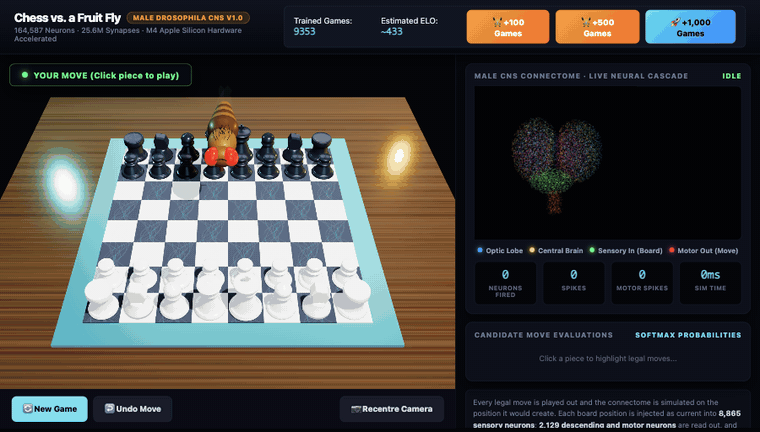

<div align="center">

# Chess vs. a Fruit Fly

**A fly picks up your pieces and carries them away.**

A 3D chess game where the opponent is an animated *Drosophila* that physically lifts the piece it wants to move, flies it across the board, and drops it on the target square. Underneath is a small neural network trained by self-play, and a telemetry panel that is honest about some things and not about others.

<br />


</div>



---

## What you're looking at

- **The fly is the opponent, and it moves the pieces.** When it decides on a move, it flies to the source square, grips the piece with its legs, carries it to the destination, and releases. Every move in the GIF above is a real game against the real model — no scripted animation.
- **Every legal move is scored by a neural network, then the best one is played.** No search tree, no opening book, no engine.
- **The sidebar is a live view of that decision:** the candidate moves, their softmax probabilities, and a 3D particle brain that pulses when the network runs.

---

## What's real and what's theatre

This project began as "a fly connectome plays chess." It is not that, and pretending otherwise would waste your time. Here is the split.

| The UI says | What is actually happening |
|:---|:---|
| **164,587 neurons** | `NUM_CENTRAL_NEURONS = 153593` is defined in `train_fly.py` and used by nothing. The model has **5,065,217 weights across four linear layers**. |
| **Neurons fired · Spikes · Motor spikes · Sim time** | Generated in `server.py` from `hash(fen)`. The same position always produces the same numbers, because they are the same numbers. No simulation runs. |
| **Estimated ELO ~433** | `200 + min(games, 20000) / 20000 × 500`. It is a progress bar wearing a chess rating's name. Measured score against a random mover: **0.50** over 50 games. See [what it actually plays like](#what-it-actually-plays-like). |
| **Dopamine reinforcement learning** | Real training loop, crude signal: one reward per game, applied identically to every position in that game. No per-move credit assignment. |
| **Trained on a connectome** | No. `weights.pt` started from random initialisation and was shaped by 9,353 games of self-play. The FlyWire wiring diagram is not loaded anywhere in this repo. |

What *is* real: the 3D board and the fly animation, the move encoder, the network, the candidate scoring, the mate-in-one assist, the self-play training loop, and the 9,353 games behind the current weights. The rest is set dressing, and the set dressing is where the fun is.

The full history — what v1 claimed, how the gap survived review, and what changed — is in [`DESIGN.md`](DESIGN.md).

---

## How the decision is made

```text
board + one candidate move
  └─ 8,865-dim sensory vector
       768   piece-square bits        (64 squares × 12 piece/colour combos)
         3   side to move, castling rights
       128   candidate move           (from-square one-hot, to-square one-hot)
       400   background noise         (deterministic, seeded by hash(fen + move))
  └─ Linear 8,865 → 512    ReLU
  └─ Linear   512 → 512    + residual, ReLU
  └─ Linear   512 → 512    + residual, ReLU
  └─ Linear   512 → 1      Tanh
  └─ score ∈ [-1, 1]
```

`select_best_move()` builds that vector **once per legal move**, runs the batch through the network, and takes the argmax. A softmax over the scores is what fills the sidebar — which is why the bars sit near 5% each: with ~30 candidates the network is not confident, and the panel shows that honestly.

Two hard-coded assists sit in front of the network:

1. If any legal move is checkmate, play it.
2. Otherwise discard every move that allows a mate in one, then score what's left.

That is the entire chess engine. There is no lookahead beyond one ply of mate detection.

---

## What it actually plays like

`bench.py` plays the model against fixed opponents. Every number below comes from it: 50 games against a random mover, 30 against a material-grabber, seed 1, capped at 150 plies. Re-run it and disagree with me.

| Opponent | Games | W–D–L | Score (95% CI) | Avg. final material |
|:---|---:|:---|:---|:---|
| Random mover | 50 | 1–48–1 | **0.50** (0.37–0.63) | −1.1 |
| Material-greedy | 30 | 1–27–2 | **0.48** (0.32–0.65) | **−24.1** |

Two things fall out of that table.

**It is a random mover with a mate filter.** Against uniform-random play it scores exactly 0.50 — one win, one loss, forty-eight draws. Of those draws, 22 hit the ply cap and 26 ended by repetition or the fifty-move rule. It does not lose to randomness, and it cannot beat it.

**A bot that only grabs material takes 24 points off it** — a queen, a rook and change — and still only mates it twice in 30 games. That bot plays the worst possible chess: it walks into mate in one every few moves, and the fly takes those mates, which is the single win. The rest of the time the fly is a queen down by move 40 and shuffles until the cap.

### The reward has the wrong sign for Black

The self-play loop trains every position in a game toward the final result *from White's point of view*:

```python
if result == "1-0":    dopamine_reward =  1.0
elif result == "0-1":  dopamine_reward = -1.0
```

`select_best_move` then plays `argmax(score)`. In a Black position, the quantity being maximised is "how likely is White to win" — so with Black the network is not playing badly, it is playing **for the opponent**.

The benchmark shows it. Same weights, same opponents:

| Fly colour | vs random | vs greedy |
|:---|---:|---:|
| White | **+2.7** material | −22.7 |
| Black | **−5.0** material | −25.5 |

One sign error, worth about eight points of material per game. It is the single highest-value fix in the repo and it is a two-line change in `train_fly.py`.

---

## Why it plays badly

The training loop plays a game, then backpropagates the final result (`+1` / `0` / `-1`) against **every position in that game**, with equal weight. A move that lost the queen in the opening and a move that delivered mate in the endgame receive the same target.

That is a single scalar reward with no credit assignment, no value bootstrapping, no policy gradient, and no search to compensate. It learns to prefer positions that resemble games it won, which is why it develops opinions and not a plan. The mate filter guarantees it never allows mate in one. 9,353 games is not enough to make it good, and no amount of extra games will fix the signal — the benchmark above is what that ceiling looks like measured.

---

## Run it

```bash
git clone https://github.com/AdilSiddiquiHQ/fly-connectome-chess.git
cd fly-connectome-chess

python3 -m venv .venv
source .venv/bin/activate        # Windows: .venv\Scripts\activate
pip install -r requirements.txt

python server.py
```

Open **http://localhost:5050**. The 20 MB `weights.pt` ships in the repo, so there is nothing to download and no API key to configure. Inference runs locally — the only outbound requests are the three JavaScript libraries the page pulls from a CDN on first load (`three.js`, `OrbitControls`, `chess.js`).

PyTorch picks the fastest device it finds — Apple Silicon MPS, CUDA, or CPU — and prints which one it chose at startup.

### The three buttons

| Button | What it does |
|:---|:---|
| **New Game** | Resets the board. Weights are untouched. |
| **Undo Move** | Steps back one of your moves. |
| **+100 / +500 / +1,000 Games** | Runs that many self-play games on your hardware, then rewrites `weights.pt` and `metadata.json`. Training is live and destructive — copy the weights first if you want to keep them. |

---

## Repo map

| Path | What's in it |
|:---|:---|
| `server.py` | Flask server on `:5050`. `/api/move` scores the position, `/api/train` runs self-play, `/api/state` reports device and game count. Also where the fake telemetry lives. |
| `train_fly.py` | The network, the 8,865-dim encoder, move selection, the mate assists, and the self-play loop. |
| `index.html` | The whole front end in one file: Three.js scene, procedural fly and Staunton pieces, the tween engine, the sidebar. |
| `weights.pt` | 5,065,217 parameters after 9,353 self-play games. |
| `metadata.json` | Games trained. Nothing else. |
| `bench.py` | Plays the model against random, material-greedy and 2-ply-greedy opponents. Every number in this README comes from it. |
| `bench-results/` | The raw game records behind those numbers, including every final FEN. |
| `DESIGN.md` | What v1 claimed, what it actually was, how the gap survived, and what changed. |

---

## If I keep working on this

- **Fix the reward sign first.** Train from the side-to-move's perspective, not White's. It is a two-line change, and the benchmark says it is worth about eight points of material per game.
- **Load the actual connectome.** FlyWire publishes the MaleCNS adjacency matrix. The honest version of this project wires the 8,865 sensory and 2,129 motor neurons to real edges and runs the network on the graph, instead of naming four `nn.Linear` layers after brain regions.
- **Replace the scalar reward with something that can assign credit** — per-move advantage, TD(λ), or a small policy head trained on self-play outcomes.
- **Add a search on top.** One ply of alpha-beta would fix most of what the benchmark above shows, and it would make the "no engine" claim a deliberate choice rather than a limitation.
- **Delete the fake telemetry or make it real.** A panel showing actual tensor shapes, real forward-pass time, and real top-k logits would be more interesting than invented spike counts.

---

## Credits

The neuron counts, the visual language, and the name come from the [FlyWire](https://flywire.ai) consortium's **MaleCNS v1.0** dataset (Janelia Research Campus, Google Research, and collaborators) — the first complete wiring diagram of an adult insect brain. It is extraordinary work and it deserves better than being a label on an MLP.

Chess rules and move generation: [`python-chess`](https://python-chess.readthedocs.io/). Rendering: [Three.js](https://threejs.org/). Nothing here would exist without either.

<div align="center">
<br />
<sub>If the fly carrying a knight made you smile, a star is the cheapest way to say so.</sub>
</div>
